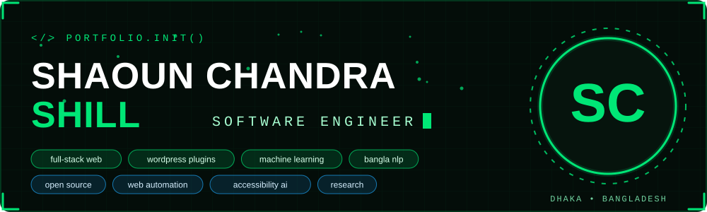
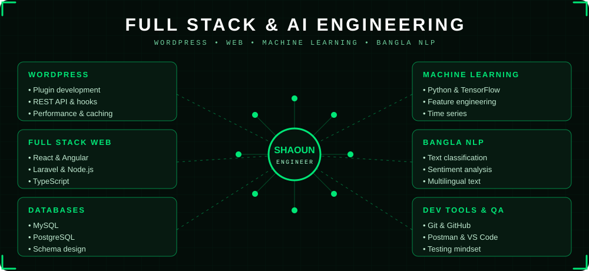
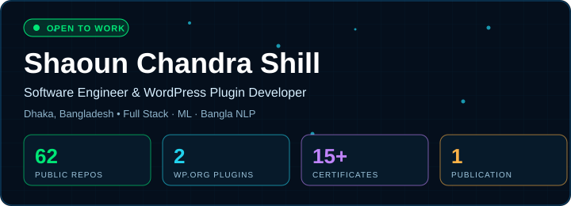
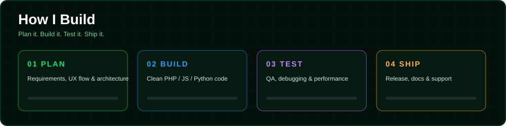
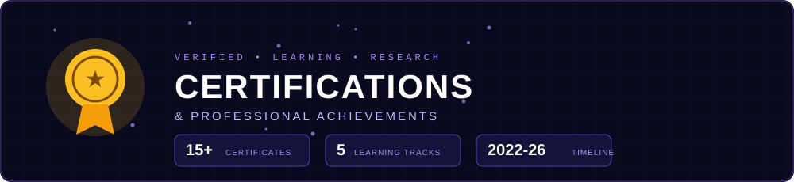
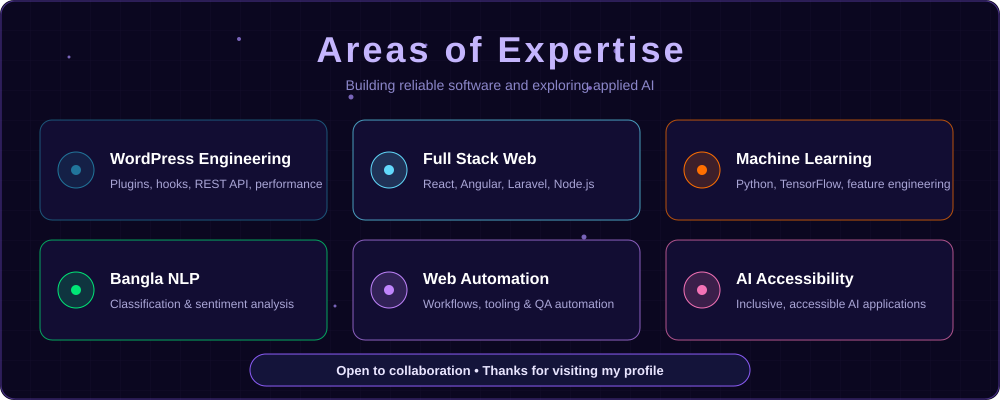

  
  

  

  

# 👤 About Me

### Shaoun Chandra Shill

**Software Engineer · WordPress Plugin Developer · Machine Learning Enthusiast**

  

I enjoy building complete software systems — from WordPress plugins and Laravel back-ends to React/Angular front-ends and ML experiments — with clean, fast and well-tested code.

- 🎓 **Field:** Software Engineering · Machine Learning · Bangla NLP
- 🧩 **Shipped:** WordPress.org-approved plugins, including **Reloadify Frontend Sync**
- 🎯 **Focus Areas:** Full Stack Web, WordPress Ecosystem, AI/ML, Web Automation
- 🔬 **Research:** NLP, AI for Accessibility, ML for Software Engineering, HCI
- 📍 **Location:** Dhaka, Bangladesh 🇧🇩
- 📫 **Contact:** [shaoun@bitbirds.com](mailto:shaoun@bitbirds.com)
- ⚡ **Fun Fact:** Built a full-stack app in 48 hours on tea and lo-fi beats 🎶

# 🌐 Socials

  
  
  
  
   
  
  
  
  

# 🚀 Featured Projects

<table>
  <tr>
    <td width="50%" valign="top">
      <h3>🔄 Reloadify Frontend Sync</h3>
      
Project 1: WordPress.org-approved developer &amp; QA plugin that reloads every open frontend tab automatically when you save in Elementor, Divi, Bricks, Oxygen, Beaver Builder or the classic editor.

      
  

      <a href="https://wordpress.org/plugins/reloadify-frontend-sync/">🔗 WordPress.org</a>
    </td>
    <td width="50%" valign="top">
      <h3>🏢 Zetta ERP</h3>
      
Project 2: Full ERP solution for WordPress — CRM, HRM and Accounts in one plugin, with a React admin UI and REST API.

      
  

      <a href="https://wordpress.org/plugins/zetta-erp/">🔗 Live</a> · <a href="https://github.com/Shaoun18/WP_Erp/">📂 Code</a>
    </td>
  </tr>
  <tr>
    <td width="50%" valign="top">
      <h3>🛒 E-Commerce Platform</h3>
      
Project 3: Full-stack online store with payment integration and an admin management system — also my published paper.

      
  

      <a href="https://demo.graygrids.com/themes/shopgrids/">🔗 Live</a> · <a href="https://github.com/Shaoun18/Shopgrids-Ecommerce-Website">📂 Code</a>
    </td>
    <td width="50%" valign="top">
      <h3>💬 Sentiment Analyzer</h3>
      
Project 4: NLP-based sentiment analysis tool built with Python, TensorFlow and NLTK.

      
  

      <a href="https://github.com/shaoun18/ml-sentiment">📂 Code</a>
    </td>
  </tr>
  <tr>
    <td colspan="2" valign="top">
      <h3>🌐 Personal Portfolio</h3>
      
Project 5: Sleek personal portfolio with modern UI/UX.  

      <a href="https://shaoun18.github.io/">🔗 Live</a> · <a href="https://github.com/Shaoun18/shaoun18.github.io">📂 Code</a>
    </td>
  </tr>
</table>

# 🛠️ Tech Stack

**Languages**

       

**Frameworks &amp; CMS**

        

**AI / Machine Learning**

    

**Databases &amp; Tools**

         

# 🔬 Research

<table>
<tr>
<td width="55%" valign="top">

### 🌟 Areas of Interest
- 📝 NLP (Bangla &amp; multilingual text)
- ⚙️ Machine Learning for Software Engineering
- ♿ AI-driven Accessibility &amp; Cybersecurity
- 👩‍💻 Empirical Software Engineering &amp; HCI
- 📈 Deep Learning (time series &amp; unsupervised)

</td>
<td width="45%" valign="top">

### 📊 Research Metrics

<!-- METRICS:START -->
| Metric | Count |
|--------|:-----:|
| 📄 Publications | **1** |
| 🔍 Citations | **1** |
<!-- METRICS:END -->

</td>
</tr>
</table>

### 📄 Publications

<!-- PUBLICATIONS:START -->
- [ShopGrids E-commerce Website Management System](https://scholar.google.com/citations?view_op=view_citation&hl=en&user=gGfY9toAAAAJ&citation_for_view=gGfY9toAAAAJ:u5HHmVD_uO8C) (2022)
<!-- PUBLICATIONS:END -->

<b>🌍 Aligned Research Groups</b>

 

- **[Neural Research Bangladesh](https://www.neuralresearchbd.com/)** — CS, ML, AI, Deep Learning
- **[CIOL – Computational Intelligence and Operations Laboratory](https://ciol-researchlab.github.io/)** — Bangla NLP, text classification, sentiment analysis
- **[TensorFlow User Group Bangladesh](https://www.linkedin.com/company/madncb)** — ML developers &amp; researchers community

# 📊 GitHub Stats

  
  
   
  

# ⏱️ Spent My Time

  
    
  
   
  

# 🎓 Certifications

  
    
  
    
    

<h3 align="center">🤖 AI &amp; Data Science</h3>

 
<table align="center">
  <tr>
    <td align="center" valign="top" width="280"><b>Artificial Intelligence Excellence</b> TotallyAiCertified · Jan 2026 </td>
    <td align="center" valign="top" width="280"><b>Data Science &amp; ML for Beginners</b> Skill.jobs · Sep 2025 </td>
    <td align="center" valign="top" width="280"><b>Data Analytics (Power BI &amp; Tableau)</b> BCET · Dec 2025 </td>
  </tr>
  <tr>
    <td align="center" valign="top" width="280"><b>Cleaning Data in Python</b> DataCamp · May 2023 </td>
    <td align="center" valign="top" width="280"><b>Feature Engineering for ML in Python</b> DataCamp · Jun 2023 </td>
    <td align="center" valign="top" width="280"><b>ML for Time Series Data in Python</b> DataCamp · Jun 2023 </td>
  </tr>
  <tr>
    <td align="center" valign="top" width="280"><b>ML with Tree-Based Models in Python</b> DataCamp · Jun 2023 </td>
    <td align="center" valign="top" width="280"><b>Unsupervised Learning in Python</b> DataCamp · Jul 2023 </td>
  </tr>
</table>

<h3 align="center">🌐 Web &amp; WordPress</h3>

 
<table align="center">
  <tr>
    <td align="center" valign="top" width="280"><b>Professional WordPress Mastery: Zero to Hero</b> UYLAB · Sep 2025 </td>
    <td align="center" valign="top" width="280"><b>Web Design &amp; Development: Laravel &amp; Vue.js</b> BITM · Oct 2022 </td>
  </tr>
</table>

<h3 align="center">🛡️ Cyber Security &amp; Software</h3>

 
<table align="center">
  <tr>
    <td align="center" valign="top" width="280"><b>Networking &amp; Cyber Security</b> Skill.jobs · Jun 2024 </td>
    <td align="center" valign="top" width="280"><b>Mobile App Development – Android</b> PencilBox · Aug 2022 </td>
    <td align="center" valign="top" width="280"><b>Oracle Certified Professional, Java SE 8 Programmer II</b> Sololearn · Mar 2020 </td>
  </tr>
</table>

<h3 align="center">🔬 Research &amp; Recognition</h3>

 
<table align="center">
  <tr>
    <td align="center" valign="top" width="280"><b>World Scientist &amp; University Rankings 2026</b> AD Scientific Index · Sep 2025 </td>
    <td align="center" valign="top" width="280"><b>Research Paper</b> CARSIT · Apr 2026 </td>
  </tr>
</table>

   
  

# 🌱 Currently Exploring

- 🧠 Large Language Models (LLMs) and Retrieval-Augmented Generation (RAG)
- 🇧🇩 Bangla NLP and text classification
- ⚡ WordPress performance, caching and developer tooling
- 🤖 Web automation and AI-assisted QA
- 🏗️ Scalable back-end architecture

# 📝 Latest Blog Posts

- [Building a Scalable E-Commerce Platform with Laravel](https://sites.google.com/view/programmershaoun/blog) — *Aug 2025*
- [Getting Started with NLP in Python](https://sites.google.com/view/programmershaoun/blog) — *Jul 2025*
- [Optimizing React Apps for Performance](https://sites.google.com/view/programmershaoun/blog) — *Jun 2025*

# ⭐ Support

If you find my projects or plugins useful, consider giving them a ⭐ — your feedback, suggestions and contributions are welcome.

  
  
  

# 🤝 What I'm Looking For

I'm open to **Software Engineering**, **WordPress development**, **QA** and **research collaboration** opportunities — including co-authorship and open-source work.

If you'd like to collaborate, discuss an opportunity, or just connect — feel free to reach out.

  

### Thanks for visiting my profile!

⭐ **If you like my work, drop a star on a repo you find useful.** ⭐

